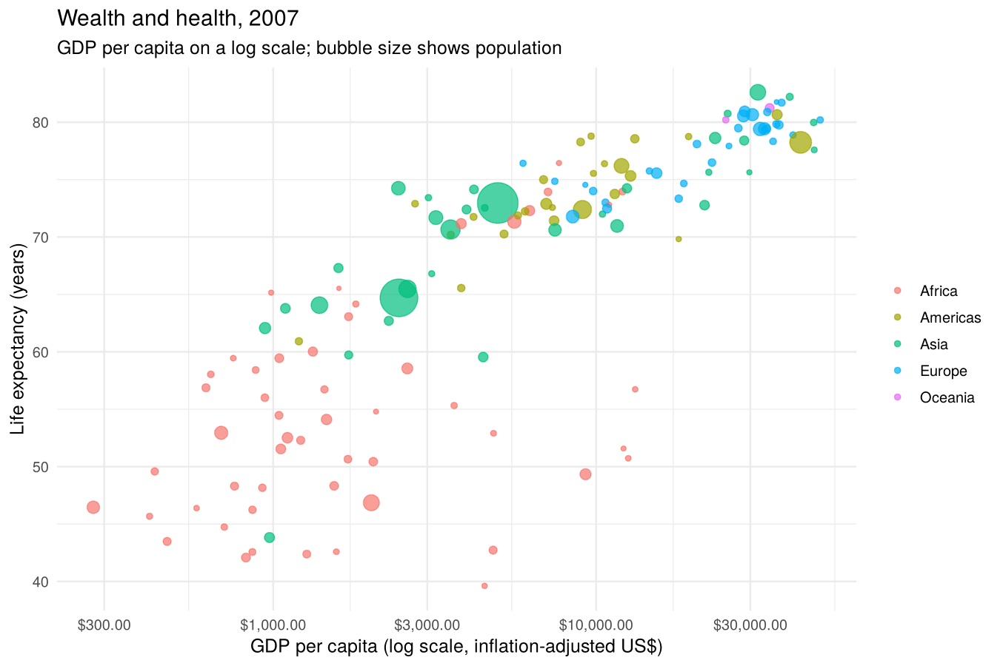
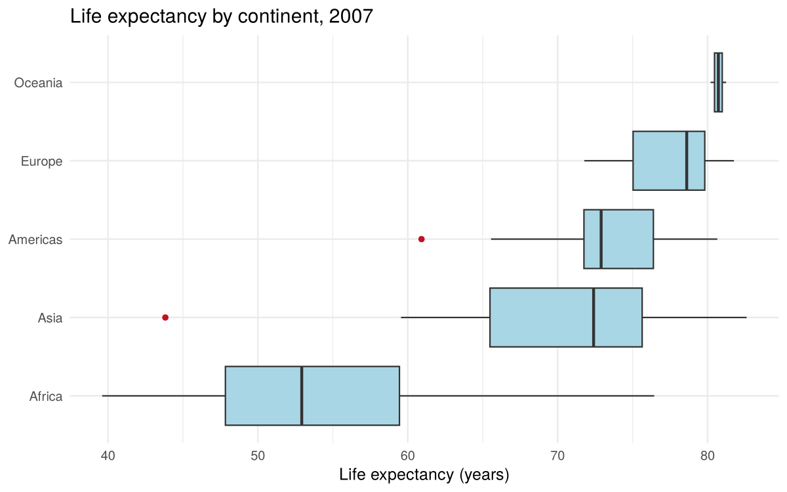
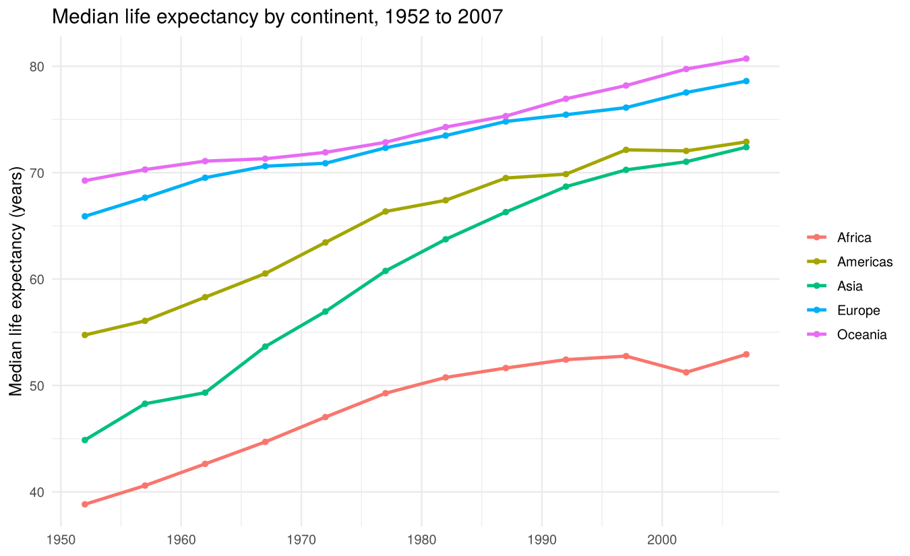
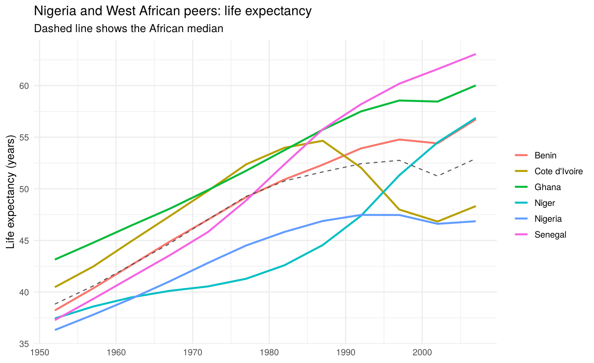

# Project 1: Exploratory Data Analysis of Global Health and Wealth (R)

**Tools:** R, dplyr, tidyr, ggplot2 &nbsp;|&nbsp; **Skills:** data inspection, descriptive statistics, distributions, correlation, trend analysis, data visualisation



## Research question

How have life expectancy and income changed across the world between 1952 and 2007, how closely are the two related, and how has Nigeria fared compared with its West African neighbours?

## Dataset description

The data come from the **Gapminder** dataset, an excerpt of the Gapminder Foundation's country-level data, distributed through the `gapminder` R package (Bryan, 2017) and accessed via the Rdatasets archive.

| Item | Detail |
|---|---|
| Rows | 1,704 (142 countries x 12 survey years) |
| Period | 1952 to 2007, every five years |
| Variables | `country`, `continent`, `year`, `lifeExp` (life expectancy at birth, years), `pop` (population), `gdpPercap` (GDP per capita, inflation-adjusted US$) |
| Missing values | None |

## Methodology

1. **Inspection:** checked structure, data types, missing values and the panel layout (every country observed in every year).
2. **Descriptive statistics:** mean, median, standard deviation and range overall, then by continent for 2007.
3. **Distributions:** histogram of life expectancy and box plots by continent. GDP per capita was compared on raw and log scales because its mean (US$11,680) is almost double its median (US$6,124) in 2007, a clear sign of right skew.
4. **Relationships:** Pearson correlation between life expectancy and GDP per capita, raw and log-transformed.
5. **Trends:** median life expectancy by continent over time, and each country's gain from 1952 to 2007.
6. **Focus area:** Nigeria compared with Ghana, Senegal, Cote d'Ivoire, Benin and Niger, plus the African median.
7. **Anomaly detection:** flagged every drop of more than three years between consecutive surveys.

## Analysis

All code is in [`eda_gapminder.R`](eda_gapminder.R). Full console output is in [`output/console_output.txt`](output/console_output.txt), and summary tables are saved as CSV files in `output/`.

**Life expectancy by continent, 2007**

| Continent | Countries | Median (years) | Mean (years) | SD | Median GDP per capita (US$) |
|---|---|---|---|---|---|
| Oceania | 2 | 80.7 | 80.7 | 0.7 | 29,810 |
| Europe | 30 | 78.6 | 77.6 | 3.0 | 28,054 |
| Americas | 25 | 72.9 | 73.6 | 4.4 | 8,948 |
| Asia | 33 | 72.4 | 70.7 | 8.0 | 4,471 |
| Africa | 52 | 52.9 | 54.8 | 9.6 | 1,452 |







## Results

* **The global gap is wide.** In 2007 the median African country had a life expectancy of 52.9 years, almost 26 years below the European median. Africa also shows the most variation between countries (SD 9.6 years).
* **Wealth and health are strongly linked, but not in a straight line.** The correlation between GDP per capita and life expectancy in 2007 was r = 0.68 on the raw scale and r = 0.81 after a log transformation. Extra income matters most at low income levels.
* **Asia improved the most.** Oman (+38.1 years), Vietnam (+33.8) and Indonesia (+33.2) recorded the largest gains between 1952 and 2007.
* **Southern Africa went backwards.** Zimbabwe (-5.0 years) and Swaziland (-1.8) ended the period below where they started, with sharp falls in the late 1990s and early 2000s in Botswana, Lesotho, Zambia and South Africa too. Rwanda's fall of 20.4 years in 1992 is the largest single drop in the data.
* **Nigeria's progress stalled.** Life expectancy rose from 36.3 years in 1952 to a peak of 47.5 in 1992, then flattened at about 46.9 by 2007. In 2007 Nigeria ranked 19th of 52 African countries for GDP per capita but only 40th for life expectancy, and it fell below Niger, which started from a similar point.

## Interpretation

The log-linear shape of the wealth and health relationship suggests that income gains in poorer countries go much further than the same gains in rich countries, which supports targeting health investment where incomes are lowest. Income alone does not tell the whole story, though. Nigeria's mid-table income position next to a low life expectancy ranking points to factors that GDP does not capture, such as how health spending is distributed, disease burden and access to care. The sharp drops in Southern Africa coincide with the period when the HIV/AIDS epidemic was at its most severe in the region, and Rwanda's 1992 figure reflects the effects of conflict, which shows how quickly hard-won gains can be lost.

## Conclusion

Global life expectancy rose substantially between 1952 and 2007, and it is strongly associated with national income on a log scale. The gains were uneven, with Asia improving fastest and parts of Southern Africa going backwards. Nigeria's plateau from the 1990s onward, despite a middling income ranking within Africa, makes it a useful case for further study of what drives health outcomes beyond wealth.

**Limitations:** this is a descriptive analysis, so the associations shown are not causal. The data stop in 2007 and use national averages that hide inequality within countries. Gapminder estimates for earlier years carry more uncertainty, and more recent UN estimates for some countries, Nigeria included, may differ from these figures.

## How to reproduce

```r
# from this folder, in R or RStudio
install.packages(c("dplyr", "tidyr", "ggplot2", "scales"))
source("eda_gapminder.R")
```

**Reference:** Bryan, J. (2017). *gapminder: Data from Gapminder*. R package. Data originally from the Gapminder Foundation, gapminder.org.
