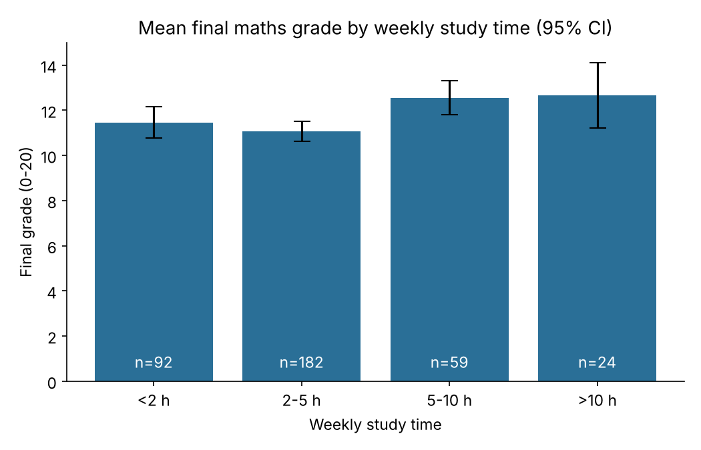
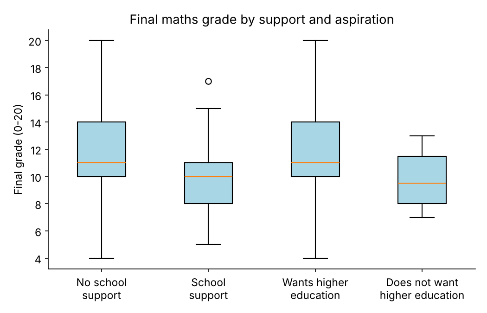

# Project 2: What Shapes Secondary School Maths Performance? (SPSS)

**Tool:** IBM SPSS Statistics &nbsp;|&nbsp; **Skills:** data screening, labelling and coding, crosstabs and chi-square, independent-samples t-tests, one-way ANOVA with post hoc tests, Pearson and Spearman correlation, effect sizes

## Research question

Which student background, support and study-habit factors are associated with secondary school students' final maths grades and with their chances of passing?

Specific questions:

1. Do final grades differ by sex, internet access at home, aspiration to higher education, or receipt of extra school support?
2. Does weekly study time make a difference to final grades?
3. How strongly are past failures, absences and parental education related to final grades?
4. Is passing associated with wanting to go on to higher education?

## Dataset description

**Source:** UCI Machine Learning Repository, *Student Performance* dataset (Cortez and Silva, 2008). Data were collected from two public secondary schools in Portugal through school reports and questionnaires.

| Item | Detail |
|---|---|
| Students | 395 (maths course) |
| Outcome | `G3`, final grade on a 0 to 20 scale (pass mark is 10) |
| Predictors used | sex, school, address, parents' education, weekly study time, past failures, school support, family support, paid classes, higher education aspiration, internet access, going out, absences, first and second period grades |
| Files | `data/student-mat.csv` (original), `data/student_performance.sav` (SPSS file with variable labels, value labels and measurement levels set) |

## Methodology

1. **Coding and labelling.** Text categories were recoded to numeric codes with value labels (for example 1 = Female, 2 = Male), and every variable was given a descriptive label and the correct measurement level (nominal, ordinal or scale).
2. **Data screening.** Frequencies and descriptives were run on every variable. **38 students (9.6%) had a final grade of 0**, while most had non-zero grades earlier in the year. This pattern points to students who did not sit the final exam rather than students who scored zero, so a `sat_exam` flag was created.
3. **Pass rate analysis (all 395 students).** Pass was defined as G3 of 10 or more, with non-sitters counted as not passing. Associations were tested with Pearson's chi-square, phi as the effect size, and expected cell counts checked (all were 5 or above).
4. **Grade analysis (357 students who sat the exam).** Normality was checked with histograms, Q-Q plots and box plots. Group differences were tested with independent-samples t-tests, with Levene's test deciding whether to report the equal-variance or Welch result, and Cohen's d as the effect size. Study time was tested with one-way ANOVA, eta squared, and Tukey HSD post hoc comparisons (Games-Howell included as a check).
5. **Correlation.** Pearson's r for the grade relationships, with Spearman's rho as a check for `absences`, which is heavily right-skewed (mean 6.3, maximum 75).

All steps are in [`analysis.sps`](analysis.sps), so the whole analysis can be rerun in one click.

## Analysis

**Independent-samples t-tests (final grade, n = 357)**

| Comparison | Group means (SD) | Levene p | Test reported | t | p | Cohen's d |
|---|---|---|---|---|---|---|
| Female vs Male | 11.21 (3.17) vs 11.87 (3.26) | .542 | Equal variances | -1.94 | .053 | 0.21 |
| Wants higher education: Yes vs No | 11.60 (3.25) vs 9.71 (1.90) | .032 | Welch | 3.51 | .003 | 0.59 |
| Internet at home: Yes vs No | 11.68 (3.26) vs 10.71 (2.97) | .173 | Equal variances | 2.12 | .035 | 0.30 |
| School support: Yes vs No | 9.62 (2.55) vs 11.83 (3.22) | .016 | Welch | -5.46 | < .001 | 0.71 |

**One-way ANOVA: final grade by weekly study time**

| Study time | n | Mean |
|---|---|---|
| Less than 2 hours | 92 | 11.47 |
| 2 to 5 hours | 182 | 11.07 |
| 5 to 10 hours | 59 | 12.56 |
| More than 10 hours | 24 | 12.67 |

F(3, 353) = 4.38, p = .005, eta squared = .036. Levene's test was not significant (p = .378), so Tukey HSD was used. The only significant pairwise difference was **5 to 10 hours vs 2 to 5 hours** (mean difference 1.49, p = .010).

**Correlations with final grade (n = 357)**

| Variable | Pearson r | p |
|---|---|---|
| Second period grade (G2) | .966 | < .001 |
| First period grade (G1) | .892 | < .001 |
| Past class failures | -.294 | < .001 |
| Absences | -.213 (Spearman rho = -.244) | < .001 |
| Mother's education | .190 | < .001 |
| Going out with friends | -.177 | .001 |
| Father's education | .159 | .003 |
| Age | -.140 | .008 |
| Weekly study time | .127 | .017 |

**Chi-square: passing by group (all 395 students)**

| Factor | Pass rate | chi-square (df = 1) | p | phi |
|---|---|---|---|---|
| Wants higher education: Yes vs No | 68.8% vs 35.0% | 9.82 | .002 | .158 |
| School support: Yes vs No | 54.9% vs 68.9% | 3.94 | .047 | .100 |
| Address: Urban vs Rural | 68.4% vs 62.5% | 1.08 | .299 | .052 |

> **SPSS output:** after running `analysis.sps`, export the output viewer (File > Export > PDF) to `output/spss_output.pdf` and add screenshots of the key tables to `figures/`.

## Results

* **Aspiration matters.** Students who want to go on to higher education scored almost two grade points higher (d = 0.59, a medium effect) and were about twice as likely to pass (68.8% vs 35.0%).
* **Past failure and absence are warning signs.** Each was negatively correlated with the final grade (r = -.29 and r = -.21), and earlier grades predicted the final grade almost perfectly (r = .97 for G2).
* **Study time helps, but not in a straight line.** Students studying 5 to 10 hours a week outscored those studying 2 to 5 hours, but study time explained only 3.6% of the variation in grades.
* **Students on extra school support scored lower** (9.62 vs 11.83, d = 0.71) and passed less often.
* **No clear gender gap.** Boys scored slightly higher, but the difference did not reach significance (p = .053, d = 0.21). Home internet access and parental education showed small positive associations, and urban vs rural address made no significant difference to pass rates.

## Interpretation

The school support finding is a good example of why association is not causation. Support is given to students who are already struggling, so lower grades among supported students most likely reflect *who* receives support, not harm caused by it. Judging the programme fairly would need prior attainment data or a comparison group.

The very strong link between first and second period grades and the final grade has a practical use: early-term results can serve as an early warning system, flagging students for intervention while there is still time to act. Past failures, absences and low aspiration add to that picture. Aspiration stands out because it is something teachers and parents can influence through mentoring and career guidance.

The small effect of study time suggests that how students study matters as much as how long they study. The dip between less than 2 hours and 2 to 5 hours is not significant and should not be overread.

## Conclusion

Final maths performance in this sample is most strongly associated with earlier attainment, past failures, absences and aspiration to higher education. Socioeconomic signals such as parental education and internet access play a smaller role, and gender shows no significant difference. For schools, the most practical lesson is to use early-term grades together with attendance and failure history to identify students at risk, and to pair academic support with work on students' goals and motivation.

**Limitations:** the data are cross-sectional and come from two Portuguese schools, so the findings may not generalise to other systems such as Nigerian or UK schools. Several variables are self-reported, multiple tests increase the chance of a false positive, and the treatment of zero grades is an assumption that should be reported alongside the results.

## Files

| File | Purpose |
|---|---|
| `analysis.sps` | Complete SPSS syntax for every step |
| `data/student_performance.sav` | Labelled SPSS data file |
| `data/student-mat.csv` | Original data (semicolon separated) |
| `build_and_check.py` | Builds the .sav file from the CSV and independently checks the SPSS results in Python |
| `figures/` | Charts used in this README |

**Reference:** Cortez, P. and Silva, A. (2008). Using Data Mining to Predict Secondary School Student Performance. In *Proceedings of the 5th Future Business Technology Conference*, pp. 5 to 12, Porto, Portugal. Data: UCI Machine Learning Repository.
