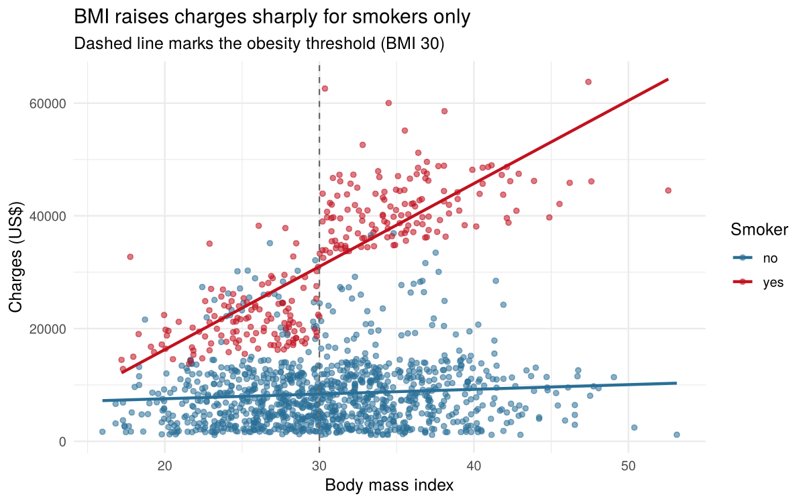
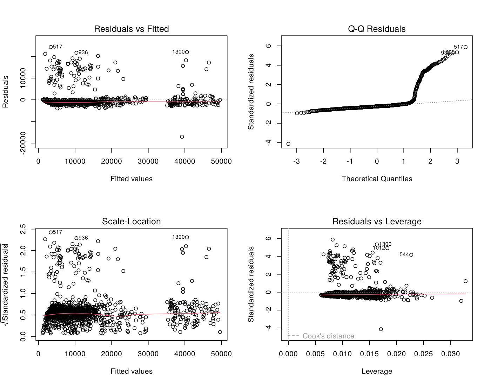

# Project 3: Modelling Medical Insurance Charges with Multiple Regression (R)

**Tools:** R, ggplot2, dplyr, car, broom &nbsp;|&nbsp; **Skills:** multiple linear regression, log transformation, polynomial and interaction terms, model comparison, train/test validation, regression diagnostics, robust standard errors



## Research question

Which personal characteristics best explain differences in annual medical insurance charges, and does the effect of body mass index depend on whether a person smokes?

## Dataset description

**Source:** *Medical Cost Personal Dataset*, from Lantz, B. (2013), *Machine Learning with R* (Packt), made publicly available through the book's GitHub repository and Kaggle. The records are simulated from US Census Bureau demographic data, so they behave like real insurance data without containing any real individual's information.

| Variable | Description |
|---|---|
| `charges` | Annual medical costs billed by health insurance (US$), the outcome |
| `age` | Age of the primary beneficiary (18 to 64) |
| `sex` | Female or male |
| `bmi` | Body mass index (kg/m²) |
| `children` | Number of dependants covered |
| `smoker` | Yes or no |
| `region` | US region: northeast, northwest, southeast, southwest |

1,338 rows, no missing values. One exact duplicate row was removed, leaving **1,337 records**.

## Methodology

1. **Exploration.** Charges are strongly right-skewed (mean US$13,279, median US$9,386). Scatter plots showed that charges rise with age in three separate bands, and that BMI only pushes charges up sharply for smokers.
2. **Feature engineering.** An `obese` indicator (BMI 30 or above) was created, following the WHO threshold, and a squared age term was added to capture faster cost growth at older ages.
3. **Validation design.** The data were split at random into an 80% training set (1,070) and a 20% test set (267), with a fixed seed so the results can be reproduced.
4. **Candidate models.**
   * **M1:** linear model with all main effects
   * **M2:** the same predictors with log(charges) as the outcome, with Duan's smearing estimator used to turn predictions back into dollars
   * **M3:** M1 plus age², the obesity indicator and a **smoker x obese interaction**
5. **Model selection.** Adjusted R² and AIC on the training data, plus RMSE, MAE and R² on the unseen test data.
6. **Diagnostics.** Residual plots, a normal Q-Q plot, variance inflation factors (VIF), Cook's distance, a non-constant variance test, and HC3 robust standard errors as a check on inference.

## Analysis

Full code: [`regression_insurance.R`](regression_insurance.R). Full output: [`output/console_output.txt`](output/console_output.txt).

**Model comparison**

| Model | Adjusted R² (train) | AIC (train) | Test RMSE (US$) | Test MAE (US$) | Test R² |
|---|---|---|---|---|---|
| M1: main effects | 0.757 | 21,619 | 6,790 | 4,649 | 0.725 |
| M2: log(charges) | 0.776 | n/a | 10,846 | 5,927 | 0.628 |
| **M3: age² + smoker x obese** | **0.878** | **20,887** | **5,435** | **2,824** | **0.824** |

M2 fitted well on the log scale but predicted worst in dollars, because a single multiplicative smoking effect cannot capture the fact that smoking costs far more when combined with obesity. M3 was best on every measure, cutting the average prediction error (MAE) by almost 40% compared with M1.

**Final model (M3 refitted on all 1,337 records)**

| Term | Estimate (US$) | 95% CI | p |
|---|---|---|---|
| Smoker (not obese) | +13,405 | 12,541 to 14,268 | < .001 |
| Obese (non-smoker) | -996 | -1,826 to -165 | .019 |
| **Smoker x Obese** | **+19,809** | 18,622 to 20,995 | < .001 |
| Age² | +3.74 | 2.27 to 5.20 | < .001 |
| BMI (per unit) | +120 | 53 to 187 | < .001 |
| Each child | +678 | 470 to 886 | < .001 |
| Male (vs female) | -495 | -975 to -15 | .043 |
| Southeast (vs northeast) | -829 | -1,519 to -139 | .019 |
| Southwest (vs northeast) | -1,223 | -1,911 to -535 | < .001 |
| Northwest (vs northeast) | -276 | -962 to 410 | .430 |

R² = 0.866, adjusted R² = 0.865, residual standard error = US$4,446, F(11, 1325) = 780.5, p < .001.

**Diagnostics**

* **Multicollinearity:** all VIFs below 3 (the highest were BMI at 2.95 and the obese indicator at 2.78, which are related by construction). This is acceptable.
* **Influence:** the largest Cook's distance was 0.039, far below the usual concern level of 1, so no single record drives the results.
* **Constant variance:** the score test was not significant (p = .89), and HC3 robust standard errors were close to the ordinary ones, so the significance conclusions do not change.
* **Normality:** the Q-Q plot shows a heavy right tail. Most of this comes from 95 people (82 of them non-smokers) whose standardised residuals are above 2, meaning their charges sit well above the model's prediction. With 1,337 records the coefficient estimates remain reliable, but individual prediction intervals should be treated with caution.





## Results

* **Smoking is by far the largest driver of cost.** Holding everything else equal, a non-obese smoker is charged about **US$13,400 more** a year than a non-obese non-smoker.
* **Smoking and obesity together multiply the cost.** For an obese smoker the extra cost rises to about **US$32,200** (13,405 - 996 + 19,809). Obesity on its own adds almost nothing for non-smokers.
* **Costs accelerate with age.** Because of the squared term, each extra year adds about US$154 at age 25, US$266 at age 40 and US$415 at age 60.
* **Smaller effects:** each dependant adds about US$680, and charges are slightly lower in the southern regions and for men.
* **Worked example:** for a 40-year-old woman in the southeast with a BMI of 32 and one child, the model predicts about **US$7,500** a year as a non-smoker and **US$40,700** as a smoker.

## Interpretation

The main lesson is that the effect of one risk factor can depend heavily on another. A simple main-effects model treats smoking as one fixed extra cost and badly underestimates the cost of the riskiest group, while the interaction model shows that the combination of smoking and obesity is where the money goes. For an insurer this argues for pricing on combined risk rather than on separate factors. For a public health planner it suggests that stop-smoking support aimed at people with obesity could give the largest reduction in costs per person.

The unexplained high-cost group among non-smokers points to factors the dataset does not record, such as chronic conditions or one-off major treatments. Adding health history would probably improve the model more than any further transformation.

## Conclusion

A multiple regression model with a smoker x obesity interaction and a squared age term explains about 87% of the variation in annual insurance charges and predicts unseen cases with a typical error of about US$2,800 (MAE). Smoking, especially combined with obesity, and age are the dominant cost drivers, while sex, region and number of children have smaller effects.

**Limitations:** the data are simulated from census statistics and describe a US insurance setting, so the dollar figures will not transfer directly to other health systems. The model is associative, not causal, the residuals are not normally distributed, and important clinical variables are missing.

## How to reproduce

```r
install.packages(c("dplyr", "ggplot2", "car", "broom"))
source("regression_insurance.R")   # run from this folder
```

**Reference:** Lantz, B. (2013). *Machine Learning with R*. Packt Publishing. Dataset: github.com/stedy/Machine-Learning-with-R-datasets.
