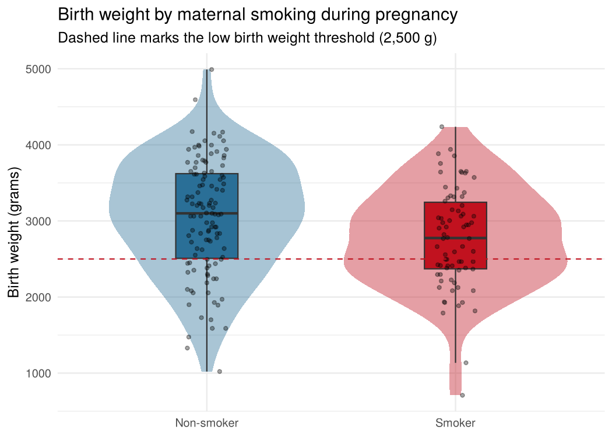
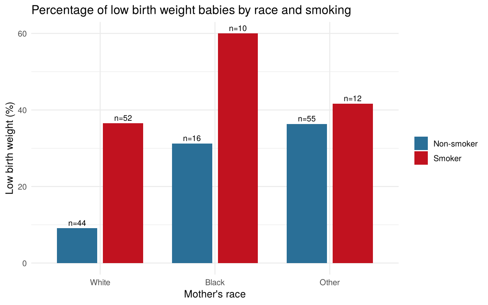

# Project 4: Maternal Risk Factors and Low Birth Weight: Hypothesis Testing and Inference (R)

**Tools:** R (stats, car, ggplot2, dplyr) &nbsp;|&nbsp; **Skills:** formulating hypotheses, checking assumptions, t-tests, chi-square and Fisher's exact tests, ANOVA with post hoc tests, non-parametric alternatives, correlation, effect sizes and confidence intervals, power analysis, multiple testing correction, logistic regression



## Research question

Is smoking during pregnancy associated with lower birth weight and a higher risk of low birth weight (under 2,500 g), and does that association hold once other maternal risk factors are taken into account?

**Hypotheses tested (two-sided, alpha = 0.05)**

| | Null hypothesis (H0) | Test |
|---|---|---|
| H1 | Mean birth weight is the same for smokers and non-smokers | Welch t-test (Mann-Whitney U as a check) |
| H2 | Low birth weight is independent of smoking | Pearson chi-square, relative risk, Fisher's exact test |
| H3 | Mean birth weight is the same across the mother's race groups | One-way ANOVA, Tukey HSD (Kruskal-Wallis as a check) |
| H4 | Hypertension and previous preterm labour are not associated with birth weight | Welch t-tests, Fisher's exact tests |
| H5 | Mother's weight and age are not correlated with birth weight | Pearson's r (Spearman's rho as a check) |

## Dataset description

**Source:** the `birthwt` data from the R package **MASS**, originally collected at Baystate Medical Center, Springfield, Massachusetts, in 1986 and published by Hosmer and Lemeshow in *Applied Logistic Regression*. It is one of the standard teaching datasets in medical statistics.

| Variable | Description |
|---|---|
| `bwt` | Birth weight in grams (outcome) |
| `low` | Low birth weight indicator (1 if under 2,500 g) |
| `smoke` | Smoked during pregnancy (1 = yes) |
| `age` | Mother's age in years |
| `lwt` | Mother's weight in pounds at her last menstrual period |
| `race` | Mother's race as recorded in the study (1 = white, 2 = black, 3 = other) |
| `ptl` | Number of previous premature labours |
| `ht` | History of hypertension |
| `ui` | Presence of uterine irritability |
| `ftv` | Number of physician visits in the first trimester |

189 births, no missing values. 74 mothers (39%) smoked during pregnancy and 59 babies (31%) had low birth weight.

## Methodology

1. **Assumption checks before every test.** Shapiro-Wilk tests and plots for normality, Levene's test for equal variances, and expected cell counts for chi-square tests. Fisher's exact test was used wherever cells were small (hypertension had only 12 cases).
2. **Robust choices by default.** Welch's t-test was used throughout because it does not need equal variances, and each parametric test was paired with a non-parametric check.
3. **Effect sizes and confidence intervals, not just p-values.** Cohen's d, eta squared, relative risk, odds ratios and 95% confidence intervals are reported for every main result.
4. **Power analysis** for the smoking comparison, to judge how much confidence a result from a sample of this size deserves.
5. **Multiple testing correction.** Seven tests were run, so p-values were adjusted with both Holm (controls the family-wise error rate) and Benjamini-Hochberg (controls the false discovery rate).
6. **Adjusted analysis.** A multiple logistic regression for low birth weight, to check whether the smoking association survives once race, mother's weight, age, hypertension, preterm history and uterine irritability are controlled for.

## Analysis

Full code: [`hypothesis_tests_birthweight.R`](hypothesis_tests_birthweight.R). Full output: [`output/console_output.txt`](output/console_output.txt).

**H1: birth weight by smoking.** Both groups passed the normality check (Shapiro-Wilk p = .33 and .42) and the variances were similar (Levene p = .21).

| Group | n | Mean (g) | SD | % low birth weight |
|---|---|---|---|---|
| Non-smoker | 115 | 3,056 | 753 | 25.2% |
| Smoker | 74 | 2,772 | 660 | 40.5% |

Welch t(170.1) = 2.73, **p = .007**, mean difference = 284 g (95% CI 79 to 489 g), Cohen's d = 0.40. Mann-Whitney check: p = .007. Post hoc power for a difference of this size with these group sizes was 0.67.

**H2: low birth weight by smoking.** chi-square(1) = 4.92, **p = .026** (Yates-corrected p = .040, Fisher's exact p = .036). All expected counts were above 23.

* Risk of low birth weight: 40.5% for smokers vs 25.2% for non-smokers, a difference of 15.3 percentage points (95% CI 1.6 to 29.0)
* **Relative risk = 1.61** (95% CI 1.06 to 2.44); odds ratio = 2.01 (95% CI 1.03 to 3.96)

**H3: birth weight by race.** F(2, 186) = 4.91, **p = .008**, eta squared = .050. Levene p = .64 and residuals were normal (p = .17). Kruskal-Wallis check: p = .014.

| Race | n | Mean (g) | Tukey comparison with White |
|---|---|---|---|
| White | 96 | 3,103 | |
| Black | 26 | 2,720 | -383 g, p = .043 |
| Other | 67 | 2,805 | -297 g, p = .026 |

**H4: other clinical factors**

| Factor | Mean birth weight (g) | % low birth weight | Welch t-test p | Fisher's exact p (low birth weight) |
|---|---|---|---|---|
| Previous preterm labour (n = 30) vs none | 2,579 vs 3,013 | 60.0% vs 25.8% | .006 | < .001 (OR 4.28) |
| Hypertension (n = 12) vs none | 2,537 vs 2,972 | 58.3% vs 29.4% | .133 | .052 (OR 3.34) |

**H5: correlation.** Mother's weight: r = .19, p = .011 (Spearman rho = .25, p < .001). Mother's age: r = .09, p = .217.

**Multiple testing correction**

| Test | Raw p | Holm | Benjamini-Hochberg |
|---|---|---|---|
| H1 Smoking (t-test) | .007 | .043 | .018 |
| H2 Smoking (chi-square) | .026 | .080 | .037 |
| H3 Race (ANOVA) | .008 | .043 | .018 |
| H4a Hypertension | .133 | .266 | .155 |
| H4b Previous preterm | .006 | .043 | .018 |
| H5a Mother's weight | .011 | .043 | .018 |
| H5b Mother's age | .217 | .266 | .217 |

**Adjusted logistic regression for low birth weight**

| Predictor | Adjusted odds ratio | 95% CI | p |
|---|---|---|---|
| **Smoked during pregnancy** | **2.33** | 1.05 to 5.19 | .038 |
| Hypertension | 6.29 | 1.59 to 24.95 | .009 |
| Previous preterm labour | 3.39 | 1.37 to 8.41 | .008 |
| Race: Black (vs White) | 3.36 | 1.18 to 9.55 | .023 |
| Race: Other (vs White) | 2.24 | 0.93 to 5.38 | .073 |
| Mother's weight (per lb) | 0.985 | 0.972 to 0.999 | .034 |
| Uterine irritability | 2.04 | 0.82 to 5.05 | .125 |
| Mother's age (per year) | 0.96 | 0.89 to 1.04 | .318 |



## Results

* **Smoking was associated with lower birth weight.** Babies of smokers weighed on average **284 g less** (p = .007, a small to medium effect, d = 0.40) and were **61% more likely** to be born with low birth weight (RR = 1.61).
* **The association held after adjustment.** Controlling for the other risk factors, smoking roughly doubled the odds of low birth weight (adjusted OR = 2.33, p = .038).
* **Clinical history mattered a great deal.** Previous preterm labour (adjusted OR 3.39) and hypertension (adjusted OR 6.29) were the strongest predictors. Hypertension did not reach significance on its own in a simple test because only 12 mothers had it, but it became clearly significant once other factors were accounted for.
* **Heavier mothers had heavier babies** (r = .19), and each extra 10 lb of maternal weight lowered the odds of low birth weight by about 14%. Mother's age showed no relationship.
* **Babies of black mothers and mothers in the "other" group were lighter on average** than babies of white mothers (by 383 g and 297 g).
* **Correction for multiple testing changed one conclusion.** Under the strict Holm correction, the chi-square result for smoking (adjusted p = .080) is no longer significant, although the t-test on the same question is (adjusted p = .043). Under Benjamini-Hochberg, all five original findings remain significant.

## Interpretation

The results agree with the wider medical evidence that smoking in pregnancy restricts foetal growth. The fact that the association survived adjustment for race, maternal weight and clinical history makes confounding by those factors a less likely explanation, although this observational study cannot prove causation on its own.

Two points show why careful inference matters. First, the power analysis (0.67) means a study of this size would miss a real effect of this magnitude about one time in three, so the non-significant hypertension result in a simple test should be read as "not enough data" rather than "no effect". The logistic regression, which uses information from all predictors, makes that clear. Second, the differences by race should not be read as biological. In 1980s US data, race is closely tied to income, access to antenatal care and stress, none of which the dataset measures. These results describe disparities in outcomes, not their causes.

For practice, the findings support targeting antenatal care at mothers who smoke, have a history of preterm labour or hypertension, or have low pre-pregnancy weight, with stop-smoking support as one of the few risk factors that can be changed during pregnancy.

## Conclusion

Smoking during pregnancy was associated with a 284 g reduction in mean birth weight and a 61% higher risk of low birth weight, and it remained an independent predictor after adjustment (adjusted OR 2.33). Previous preterm labour, hypertension and lower maternal weight were also important risk factors. The findings are consistent across parametric and non-parametric tests, although the smoking chi-square result is sensitive to the choice of multiple testing correction.

**Limitations:** a modest sample (189 births) from one hospital in 1986; no data on how much mothers smoked, gestational age, income or antenatal care; small subgroups (12 mothers with hypertension); and an observational design that supports association, not causation.

## How to reproduce

```r
install.packages(c("dplyr", "ggplot2", "car"))
source("hypothesis_tests_birthweight.R")   # run from this folder
```

**References:** Hosmer, D.W. and Lemeshow, S. (1989). *Applied Logistic Regression*. New York: Wiley. Venables, W.N. and Ripley, B.D. (2002). *Modern Applied Statistics with S*, 4th ed. Springer (MASS package).
