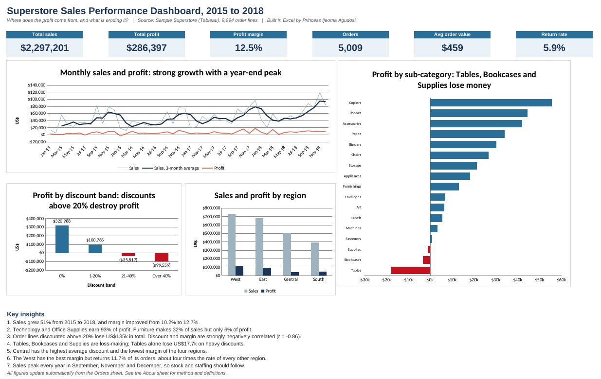

# Project 5: Sales and Profitability Dashboard (Excel)

**Tool:** Microsoft Excel &nbsp;|&nbsp; **Skills:** data cleaning, Excel tables, SUMIFS, COUNTIFS, AVERAGEIFS, INDEX/MATCH, CORREL, calculated columns, conditional formatting, chart design, KPI dashboard layout, data storytelling

**Download the workbook:** [`superstore_dashboard.xlsx`](superstore_dashboard.xlsx)

## Research question

Where does a retailer's profit come from, and what is eroding it? Specifically, how do sales and profit vary by year, region, product category, customer segment and level of discount?

## Dataset description

**Source:** the *Sample Superstore* dataset, Tableau's standard sample data, via the public GitHub repository `leonism/sample-superstore`. It describes a fictional US office-supplies, furniture and technology retailer.

| Item | Detail |
|---|---|
| Order lines | 9,994 (5,009 orders) |
| Period | January 2015 to December 2018 |
| Key fields | order and ship dates, ship mode, customer segment, region, state, city, category, sub-category, product, sales, quantity, discount, profit |
| Supporting tables | People (the manager for each of the four regions) and Returns (orders that were returned) |

## Methodology

1. **Data cleaning.** The downloaded CSV turned out to contain **three tables stacked on top of each other**: Orders (9,994 rows), People (4 rows) and Returns (800 rows). These were split into separate sheets, and **504 duplicate rows** were removed from Returns, leaving 296 unique returned orders. Dates were converted to real Excel dates, and order totals were checked against the known published totals for the dataset.
2. **Structured data.** Each sheet was converted into an Excel Table (`tblOrders`, `tblReturns`, `tblPeople`) so that ranges stay correct and filters are built in.
3. **Calculated columns** on the Orders sheet:
   * `Year` and `Month` from the order date
   * `Profit Margin` = profit / sales
   * `Discount Band` with nested IF (0%, 1-20%, 21-40%, over 40%)
   * `Returned` by looking up the Returns table with COUNTIF
   * `Regional Manager` with INDEX/MATCH on the People table
   * `New Order`, a flag on the first line of each order, so orders can be counted without double counting multi-line orders
4. **Analysis sheet.** Nine summary tables built entirely from formulas (SUMIFS, COUNTIFS, AVERAGEIFS, CORREL, and a three-month moving average), with conditional formatting to highlight losses in red. Nothing is typed in by hand, so every figure updates if the data change.
5. **Dashboard sheet.** Six KPI cards and four native Excel charts, with gridlines removed and the layout set to print on one landscape page. Colour carries meaning: **red is used only for loss-making items**, so the eye goes straight to the problems. Every chart title states its finding rather than just naming the variables.

## Analysis

**Headline figures:** total sales US$2,297,201, total profit US$286,397, profit margin 12.5%, 5,009 orders, average order value US$459, order return rate 5.9%.

**By year**

| Year | Sales | Profit | Margin | Sales growth |
|---|---|---|---|---|
| 2015 | $484,247 | $49,544 | 10.2% | |
| 2016 | $470,533 | $61,619 | 13.1% | -2.8% |
| 2017 | $609,206 | $81,795 | 13.4% | +29.5% |
| 2018 | $733,215 | $93,439 | 12.7% | +20.4% |

**By region**

| Region | Manager | Sales | Profit | Margin | Average discount | Order return rate |
|---|---|---|---|---|---|---|
| West | Anna Andreadi | $725,458 | $108,418 | 14.9% | 10.9% | 11.7% |
| East | Chuck Magee | $678,781 | $91,523 | 13.5% | 14.5% | 3.1% |
| Central | Kelly Williams | $501,240 | $39,706 | 7.9% | 24.0% | 3.3% |
| South | Cassandra Brandow | $391,722 | $46,749 | 11.9% | 14.7% | 2.9% |

**By category**

| Category | Share of sales | Share of profit | Margin |
|---|---|---|---|
| Technology | 36.4% | 50.8% | 17.4% |
| Office Supplies | 31.3% | 42.8% | 17.0% |
| Furniture | 32.3% | 6.4% | 2.5% |

**The effect of discounting**

| Discount band | Share of order lines | Sales | Profit | Margin |
|---|---|---|---|---|
| 0% | 48.0% | $1,087,908 | $320,988 | 29.5% |
| 1-20% | 38.1% | $846,522 | $100,785 | 11.9% |
| 21-40% | 4.6% | $234,138 | -$35,817 | -15.3% |
| Over 40% | 9.3% | $128,632 | -$99,559 | -77.4% |

Correlation between discount and profit margin across order lines: **r = -0.86**.

**Loss-making sub-categories:** Tables (-$17,725, average discount 26%), Bookcases (-$3,473, 21%) and Supplies (-$1,189).

## Results

1. **The business is growing and getting more efficient.** Sales grew 51% between 2015 and 2018, and margin rose from 10.2% to 12.7%.
2. **Profit is concentrated.** Technology and Office Supplies earn 93% of profit. Furniture brings in almost a third of sales but only 6% of profit, at a 2.5% margin.
3. **Heavy discounting destroys profit.** Order lines with discounts above 20% are only 14% of lines but lose US$135,000 between them, almost half of the company's total profit.
4. **Central is the weakest region**, with the highest average discount (24%) and the lowest margin (7.9%).
5. **The West has a returns problem.** It is the most profitable region but returns 11.7% of its orders, about four times the rate in every other region.
6. **Sales are seasonal**, peaking every year in September, November and December.

## Interpretation

The pattern points to pricing policy rather than product demand as the main threat to profit. Discounts up to 20% still leave a positive margin, but beyond that point almost every sale loses money, and the strong negative correlation (r = -0.86) shows how tightly margin follows discount. Central's poor performance lines up with its unusually high discounting, which suggests a regional pricing practice worth reviewing. Tables and Bookcases are bulky, heavily discounted products, so their losses may also reflect shipping costs that the discount does not cover.

The West's return rate deserves a separate look. Returns erode profit after the sale and are not visible in the profit column, so the West's true margin may be lower than it appears.

Because discount levels and product mix move together, this analysis shows association rather than a controlled estimate of the discount effect. A pricing experiment or a regression controlling for product would firm this up.

## Conclusion

The Superstore is growing and profitable overall, but its margin is being held back by deep discounting, especially in the Central region and on furniture. Three practical recommendations follow: **cap routine discounts at 20%** unless a manager approves an exception, **review pricing and shipping costs for Tables and Bookcases**, and **investigate why the West returns so many more orders** than the other regions. Stock and staffing should be planned around the September to December peak.

**Limitations:** the data are fictional, so the dollar figures are illustrative. The dataset records profit but not its cost components, and the analysis is descriptive rather than causal.

## Files

| File | Purpose |
|---|---|
| `superstore_dashboard.xlsx` | The workbook: Dashboard, About, Orders, Returns, People and Analysis sheets (70,000+ live formulas) |
| `data/superstore_raw.csv` | Original download, with the three tables stacked as received |
| `build_workbook.py` | Script used to split the raw file and lay out the workbook. All calculations live in Excel formulas |
| `figures/dashboard_preview.png` | Dashboard preview |

**Source:** Tableau Sample Superstore dataset, via github.com/leonism/sample-superstore.
